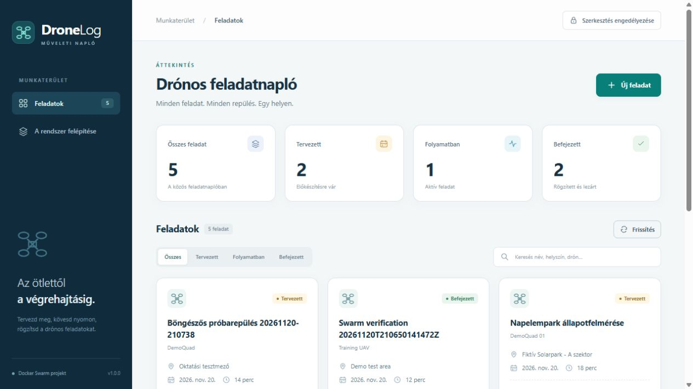
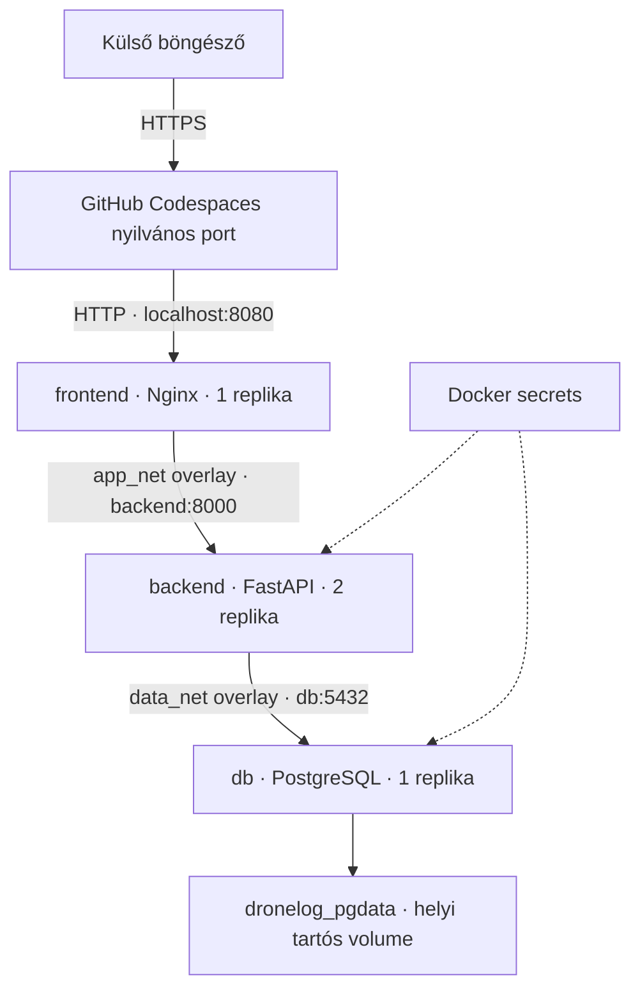

# DroneLog – drónos feladatnapló Docker Swarm környezetben

Felhőszámítás / Cloud Computing projekt. A böngészős alkalmazás drónos feladatokat rögzít, lekérdez, módosít és töröl. Minden bemutatóadat kitalált. A rendszer valódi PostgreSQL-adatbázist és három különböző Swarm-szolgáltatást használ.

Az [élő bemutató forgatókönyve](docs/VEDES.md) a bemutatógép indítását, a skálázást és a kieső konténer pótlását is bemutatja.

<!-- SUBMISSION:START -->
## Beadási adatok

- [A projekt forráskódja](https://github.com/szoporitamas99/dronelog-swarm)
- [Rövid projektjelentés (PDF)](docs/DroneLog_Projektjelentes.pdf)
- [Docker Swarm ellenőrzések a GitHub Actionsben](https://github.com/szoporitamas99/dronelog-swarm/actions/workflows/swarm.yml). A sikeres futás `dronelog-evidence` csomagjában található a mérésből készült PDF, a parancsnapló, a teszteredmények és a böngészős visszaolvasás képe.
- [A működő DroneLog megnyitása](https://upgraded-goldfish-vjwqvwg7g4cw5jp-8080.app.github.dev/). Az első megnyitáskor a GitHub **Continue** gombja vezet a naplóhoz. A megtekintés nyilvános, a szerkesztés kulcshoz kötött.
- [Az élő példány mérési bizonyítékai](evidence/run_20261120T210650141472Z/) · [Védési segédlet és indítás](docs/VEDES.md) · [Beadáshoz kimásolható hivatkozások](docs/BEADAS.txt)

A nyilvános cím az **upgraded goldfish** nevű Codespace futása alatt él. Ha a gép inaktivitás miatt leállt, a tulajdonos a [Codespaces-listáról](https://github.com/codespaces) indíthatja újra. Az alábbi Windows-telepítés ugyanennek a rendszernek a saját gépen futtatható változata.
<!-- SUBMISSION:END -->

### Az élő bemutatógép ellenőrzése · 2026. november 20.

| Tanári követelmény | Mért eredmény |
| --- | --- |
| Rögzítés a webes felületen | A Chromium űrlapon beküldött `DL-0005` rekord HTTP 201 választ kapott, majd oldalfrissítés után újra megjelent. |
| Skálázás | A backend a mérésben 2-ről 3 futó példányra bővült, majd visszaállt 2-re. |
| Automatikus helyreállás | A leállított `wepptm71sjlq` taskot a Swarm a `7wcilnk4uz8r` taskkal pótolta. |
| Tartós adattárolás | A PostgreSQL-konténer újralétrehozása után a `DL-0004` rekord megmaradt a mentett „befejezett” állapotban. |
| Külső elérés | A nyilvános HTTPS-címen öt rekord jelent meg egy külön böngészőben, köztük a két tesztrekord. |



## 1. Funkciók

- Feladat létrehozása: cím, fiktív helyszín, drón, dátum, repülési idő, állapot és megjegyzés.
- Feladatok keresése, szűrése, szerkesztése és törlése.
- Státuszok: tervezett, folyamatban, befejezett.
- Összesítők és a befejezett feladatok repülési ideje.
- Nyilvános olvasás; a módosításhoz külön szerkesztőkulcs szükséges.
- Az API-példány azonosítója lekérdezhető a replikák szemléltetéséhez.

Ez oktatási feladatnyilvántartó, nem repülésvezérlő vagy hatósági repülési engedélyező rendszer.

## 2. Architektúra



| Szolgáltatás | Feladat | Alap replikaszám | Publikus hostport |
| --- | --- | ---: | --- |
| `dronelog_frontend` | HTML/CSS/JavaScript és `/api/` reverse proxy | 1 | 8080 |
| `dronelog_backend` | Python/FastAPI, validálás, jogosultság, SQL | 2 | nincs |
| `dronelog_db` | PostgreSQL, séma és perzisztencia | 1 | nincs |

Alaphelyzetben a három szolgáltatás négy alkalmazáskonténert futtat. A bemutatógépen a telepítő a `localhost:5000` registrybe tölti fel a saját image-eket. A Swarm a frontend 8080-as portját `mode: host` beállítással nyitja meg, ezt továbbítja a nyilvános HTTPS-címre a GitHub. A saját gépen futtatott változatnál a külső elérést a cloudflared biztosíthatja.

A frontend az `app_net`, az adatbázis a `data_net` overlay hálózaton van. Az API mindkettőhöz kapcsolódik. Az Nginx a `backend` szolgáltatásnévre küldi a kéréseket, a Swarm pedig a szolgáltatás virtuális IP-címén keresztül továbbítja azokat a futó példányoknak.

Az adatbázis a `dronelog.db=true` címkéjű node-ra van kötve, mert a local driverrel létrehozott volume annak a node-nak a lemezén él. A bemutató egy node-ra készült. Több node-ra bővítésnél ez a megkötés továbbra is szükséges, vagy valódi közös tároló és külön adatbázis-HA-megoldás kell.

## 3. Előfeltételek

- Windows 11 + Docker Desktop WSL 2 háttérrel, **Linux containers** módban; vagy Linux + Docker Engine.
- Docker Hub-fiók két saját image tárolására. A belépést a saját terminálban végezd.
- GitHub-fiók és Git a forráskód feltöltéséhez.
- `cloudflared` a nyilvános eléréshez.
- Internet a build/push és a tunnel idejére; a gép maradjon ébren a bemutatón.
- A Linux/Bash segédscriptekhez Python 3 is szükséges; a Windows PowerShell útvonalhoz nem.

Python, Node.js és PostgreSQL külön telepítése a Windows gépre nem szükséges: a futó alkalmazás függőségei a konténerekbe kerülnek. A Pythonos fejlesztői tesztek külön, opcionális lépések.

## 4. Build és Swarm-telepítés – Windows PowerShell

A projekt könyvtárában:

```powershell
docker version
docker info --format '{{.OSType}}'
docker login -u SAJAT_DOCKERHUB_NEV
powershell -NoProfile -ExecutionPolicy Bypass -File .\scripts\deploy.ps1 -DockerHubUser SAJAT_DOCKERHUB_NEV
```

A `SAJAT_DOCKERHUB_NEV` helyére a valódi, kisbetűs Docker Hub-felhasználóneved kerül; nem az e-mail-címed. A Bypass kizárólag az elindított PowerShell-folyamatra vonatkozik. A script ellenőrzi a Docker-környezetet, szükség esetén Swarmot inicializál, elkészíti és feltölti a két saját image-et, létrehozza a titkokat és a volume-ot, majd `docker stack deploy` paranccsal telepít. A registry push a kiírás önálló követelménye.

Linuxon a megfelelő belépés után:

```bash
docker login -u SAJAT_DOCKERHUB_NEV
bash scripts/deploy.sh SAJAT_DOCKERHUB_NEV 1.0.0
```

Az image-nevek: `SAJAT_DOCKERHUB_NEV/dronelog-frontend:1.0.0` és `SAJAT_DOCKERHUB_NEV/dronelog-backend:1.0.0`. Módosított kiadáshoz adj új taget, például `-Tag 1.0.1`. A Dockerfile-ok és a PostgreSQL image konkrét verziót rögzítenek. A tag nem azonos egy változtathatatlan tartalomazonosítóval; a Swarm telepítéskor registryből digestet old fel, a tényleges image-azonosítók a mérési kimenetben ellenőrizhetők.

A `.env.example` dokumentációs minta. A `docker stack deploy` nem tölti be automatikusan a `.env` fájlt: a telepítő a tényleges process environmentbe állítja a szükséges változókat.

Ellenőrzés:

```powershell
docker node ls
docker stack services dronelog
docker stack ps dronelog
Invoke-RestMethod http://localhost:8080/api/health
```

A kívánt replikaszám `frontend 1/1`, `backend 2/2`, `db 1/1`. Ez elvárt állapot, nem előre rögzített mérési eredmény.

## 5. A felület használata

Nyisd meg: **http://localhost:8080**. A szerkesztőkulcs helyi megjelenítése:

```powershell
Get-Content .\.secrets\admin_token.txt
```

A kulcsot a felület szerkesztésengedélyező ablakába másold. Ez titok: ne kerüljön képernyőképbe, README-be, beadási szövegbe vagy GitHubra. A frontend a kulcsot az adott böngészőlap munkamenetében tárolja; a backend ellenőrzi a `X-Admin-Token` fejlécet. A nyilvános olvasás nem igényli ezt a kulcsot.

Hozz létre egy új, egyedi nevű tesztfeladatot a **webes felületen**, mentsd el, majd frissítsd az oldalt. Ezzel külön teljesül a kiírás böngészős rögzítési és visszaolvasási pontja; egy API-teszt ezt önmagában nem helyettesíti.

## 6. Nyilvános internetes elérés

Második terminálban, a helyi működés ellenőrzése után:

```powershell
cloudflared tunnel --url http://localhost:8080
```

Másold ki a program által ténylegesen kiírt `https://….trycloudflare.com` címet. Kapcsold ki a telefon Wi-Fi-jét, és mobilinternetről nyisd meg. Az alkalmazás és a lekérdezett feladatok is legyenek láthatók. A tunnel HTTPS-bejáratot ad a saját gépeden futó rendszerhez; a konténereket továbbra is a saját Swarm futtatja.

A cím ideiglenes, újraindításkor változik, és a tunnel leállításakor megszűnik. A linket frissítsd a README-ben és a beadási felületen, ha megváltozott. Routeres porttovábbítás nem része ennek a megoldásnak. Ne publikáld külön a PostgreSQL vagy a Docker daemon portját.

## 7. Kötelező tesztek és valódi bizonyíték

```powershell
powershell -NoProfile -ExecutionPolicy Bypass -File .\scripts\test.ps1 -PublicUrl 'IDE_MASOLD_A_VALODI_HTTPS_URLT'
```

Tunnel nélkül a `-PublicUrl` elhagyható; ekkor a nyilvános URL HTTP-tesztje kimarad. Linux: `bash scripts/test.sh --public-url https://…trycloudflare.com`.

A teszt kizárólag ehhez a projekthez tartozó szolgáltatásokat változtatja, de a helyreállási és perzisztenciapróba rövid megszakítást okozhat. A teszt végén visszaállítja a kezdeti API-replikaszámot. Az egyedi nevű tesztrekord a bizonyítékhoz megmarad.

| Követelmény | Ellenőrzés | Bizonyíték |
| --- | --- | --- |
| Adatrögzítés és visszaolvasás | Automatikus API-kérés és külön kézi böngészős próba | JSON és UI-képernyőkép |
| Skálázás | Backend 2 → 3, tényleges Running taskok ellenőrzése | Előtte/utána állapot |
| Öngyógyítás | Egy backendkonténer leállítása, új task/konténer kivárása | Régi és új azonosító |
| Perzisztencia | DB-task újralétrehozása, ugyanazon rekord visszaolvasása | Régi és új DB-taskazonosító + megmaradó rekord |
| Külső elérés | Publikus HTTP-teszt + kézi próba másik hálózatról | URL, időpont, mobilos képernyőkép |

Eredmények: `evidence/run_.../test-results.json` és `commands.txt`. A JSON a mért sikeres, hibás és kihagyott pontokat külön kezeli; a kézi próbák alapállapotban függőben maradnak. A tesztprogram sikere nem állítja automatikusan, hogy a telefonos vagy webes kézi próba megtörtént.

### Rövid PDF-dokumentáció elkészítése

A saját futtatás után:

```powershell
powershell -NoProfile -ExecutionPolicy Bypass -File .\scripts\make-report.ps1 -StudentName 'SAJAT NEV' -RepositoryUrl 'https://github.com/SAJAT_NEV/drone-swarm' -PublicUrl 'IDE_MASOLD_A_VALODI_HTTPS_URLT'
```

Az útmutató szerint külön hozzáadhatók a valóban elvégzett kézi ellenőrzések. A létrejövő `docs/Beadasi_dokumentacio.html` böngészőből **Nyomtatás → Mentés PDF-ként** művelettel menthető. A jelentés az aktuális mérésekből készül, nem feltételezett sikerekből. A PDF mellé őrizd meg a nyers parancskimeneteket és a képernyőképeket is.

## 8. Titokkezelés és korlátok

- A jelszó és a szerkesztőkulcs Docker secret. A `.secrets/` helyi generált fájljait a `.gitignore` kizárja.
- A backend és a frontend nem root felhasználóként fut; az SQL paraméterezett, a bemenet ellenőrzött.
- A backend/adatbázis port nincs publikálva. A host 8080-as portja a Docker portközzététel miatt a helyi hálózatból is elérhető lehet; ez nem loopback-only kötés.
- A demo PostgreSQL-fiókja az image inicializáló adatbázis-tulajdonosa. Éles rendszerben külön, szűkített alkalmazásjogosultságú fiók és migrációs szerepkör indokolt.
- A szerkesztőkulcs egyszerű demóvédelem, nincs többfelhasználós szerepkörkezelés vagy felhasználói auditnapló.
- Egy node kiesése az egész alkalmazást leállítja. A konténerpótlás tesztje nem node-szintű hibatűrés.
- A local volume konténer-újralétrehozás után megmarad, de nem biztonsági mentés, és nem követi automatikusan az adatbázist másik node-ra.
- A PostgreSQL csak üres adatkönyvtárnál futtatja az `init.sql` fájlt. A későbbi sémaváltozás külön migrációt igényel.
- A lista legfeljebb 500 sort ad vissza egy kérésre; az API limit/offset lapozást biztosít. A felület az első 500 rekordot jeleníti meg.
- A Quick Tunnel ideiglenes, nincs rendelkezésreállási garancia. A gép, a Docker Desktop és a tunnel maradjon bekapcsolva a bemutató idején.

A bemutató után a tunnel termináljában **Ctrl+C** megszünteti a nyilvános elérést. A teljes stack opcionális leállítása: `docker stack rm dronelog`. Ez nem törli a külső `dronelog_pgdata` volume-ot vagy a külső secret objektumokat. A tartós volume-ot ne töröld a perzisztenciateszt részeként.

## 9. Projektfájlok és megértés

| Hely | Tartalom |
| --- | --- |
| `frontend/` | HTML, CSS, JavaScript, Nginx-konfiguráció és saját Dockerfile |
| `backend/` | API, validáció, PostgreSQL-adatelérés, rögzített Python-függőségek és Dockerfile |
| `database/init.sql` | Séma és három fiktív demófeladat |
| `stack.yml` | Swarm-szolgáltatások, hálózatok, titkok, volume, replikáció |
| `scripts/` | Telepítés, mérések és jelentéskészítés |
| `tests/` | Backend egységtesztek |
| `docs/` | Indulási útmutató, követelménymátrix, védési segédlet és dokumentáció |
| `evidence/` | Saját futtatásból származó bizonyítékok |

Az egységteszteket a `backend/requirements-test.txt` szerinti fejlesztői környezetben futtasd. A pontos parancs a tesztfájlban és a `docs/ELLENORZES.md` fájlban szerepel. Ezek a tesztek nem helyettesítik a Swarm- és külsőelérés-próbákat.

## 10. Hivatalos források

Ellenőrzés dátuma: 2026. november 20.

- Docker: [Stack telepítése Swarmba](https://docs.docker.com/engine/swarm/stack-deploy/)
- Docker: [`docker stack deploy`](https://docs.docker.com/reference/cli/docker/stack/deploy/)
- Docker: [Docker Desktop Windows telepítése](https://docs.docker.com/desktop/setup/install/windows-install/)
- Docker: [Overlay hálózat](https://docs.docker.com/engine/network/drivers/overlay/)
- Docker: [Docker secrets](https://docs.docker.com/engine/swarm/secrets/)
- Docker: [Változóhelyettesítés, `.env` és Swarm-korlát](https://docs.docker.com/compose/how-tos/environment-variables/variable-interpolation/)
- PostgreSQL: [Hivatalos Docker image és inicializálás](https://hub.docker.com/_/postgres)
- Cloudflare: [Quick Tunnels](https://developers.cloudflare.com/tunnel/get-started/quick-tunnels/)
- Cloudflare: [cloudflared letöltése](https://developers.cloudflare.com/tunnel/downloads/)
- GitHub: [Repository létrehozása](https://docs.github.com/en/repositories/creating-and-managing-repositories/quickstart-for-repositories)

A projektkövetelmények alapja a felhasználó által mellékelt háromoldalas `Docker_Swarm_projektfeladat.pdf`, különösen a 3–9. fejezet. A forráskiírást nem tesszük a nyilvános repositoryba.
